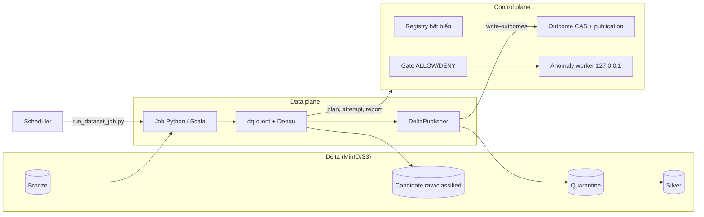
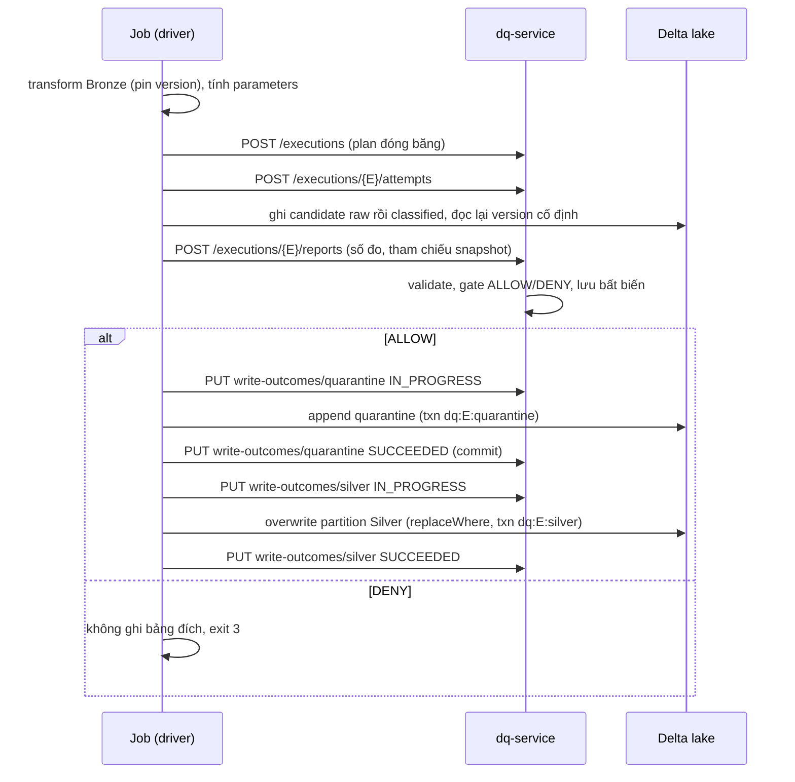

# DQ Platform — Data Quality Service + Spark + Deequ + Delta

Hệ thống kiểm data quality tách control plane và data plane, dùng làm **cổng ghi (write gate)** cho bảng Delta:

- **Control plane: `dq-service`** (FastAPI + PostgreSQL 16). Không chạm dữ liệu. Giữ registry bất biến (dataset, suite, policy, purpose, compat manifest), đóng băng **execution plan**, nhận report, quyết định `ALLOW`/`DENY` (hoặc assessment `PASS`/`VIOLATION`/`ERROR` cho audit), theo dõi kết quả ghi và con trỏ publication.
- **Data plane: job Spark** + thư viện **`dq-client`** (Scala, chạy [Deequ](https://github.com/awslabs/deequ) trong Spark). Job Scala gọi trực tiếp, job Python gọi qua py4j; cả hai dùng chung một bộ diễn giải rule và một publisher Delta. Chỉ plan, report (số đo, hash, tham chiếu snapshot) và kết quả ghi đi qua HTTP, không có dòng dữ liệu.
- **Anomaly worker** (`jvm/dq-anomaly-worker`): process JVM riêng nghe `127.0.0.1` cùng container với service, chỉ cho cảnh báo tham khảo (advisory), không bao giờ chặn gate.

Stack: Spark 3.5.1, Scala 2.12.18, Deequ `2.0.21-spark-3.5`, Delta 3.2.0, Java release 11, build bằng Maven. API: `/api/v2`. Định dạng suite: `dq-rules/v3`.

`frontend/` là console vận hành tùy chọn. Local: `cd frontend && bun install && bun run dev`; đặt `DQ_API_URL` nếu API không nghe tại `127.0.0.1:8000`. Bearer token chỉ tồn tại trong memory của trang. Compose deployment dùng profile `ui`.

| Tài liệu | Đọc khi |
|---|---|
| [dq-service/README.md](dq-service/README.md) | Cần API, token registry, vòng đời execution, cách gate quyết định, restore, retention, anomaly |
| [jvm/dq-client/README.md](jvm/dq-client/README.md) | Cần hiểu `startWrite → evaluate → submit → publish`, publisher Delta, thêm `kind` |
| [jvm/dq-jobs/README.md](jvm/dq-jobs/README.md) | Cần chạy job Scala, audit, bootstrap bảng, restore probe, maintenance |
| [spark/README.md](spark/README.md) | Cần build image, cấu hình `spark.dq.*`, job Python, sinh Bronze mẫu |
| [docs/RULE_SPEC_V2.md](docs/RULE_SPEC_V2.md) | Viết rule (`dq-rules/v3`) và policy |
| [docs/DEEQU_MIGRATION_PLAN.md](docs/DEEQU_MIGRATION_PLAN.md) | Tài liệu lịch sử của đợt chuyển sang Deequ (thiết kế cũ, không mô tả hệ thống hiện tại) |

Hai cặp phải đổi cùng nhau: định dạng suite/policy/plan ([models.py](dq-service/models.py) với [PlanRules.scala](jvm/dq-client/src/main/scala/dqplatform/client/PlanRules.scala) và [Protocol.scala](jvm/dq-client/src/main/scala/dqplatform/client/Protocol.scala)), và transform của hai job ([bronze_to_silver.py](spark/jobs/bronze_to_silver.py) với [TransactionsTransform.scala](jvm/dq-jobs/src/main/scala/dqplatform/jobs/TransactionsTransform.scala)).

```
.
├── docker-compose.yml                 # postgres, minio, dq-service (+worker), spark (profile jobs)
├── postgres/
│   ├── init.sql                       # schema v2 (include migrations/002_execution_v2.sql)
│   └── migrations/002_execution_v2.sql
├── dq-service/                        # control plane (app, models, store, policy, auth, anomaly, canonical, budget...)
├── suites/silver_transactions.json    # envelope mẫu {dataset, workflow, purpose, suite, policy}
├── jvm/
│   ├── dq-client/                     # SDK: plan, đo Deequ, phân loại, publisher Delta
│   ├── dq-jobs/                       # job Scala: bronze->silver, audit, bootstrap, restore probe, maintenance, compat probe
│   └── dq-anomaly-worker/             # worker anomaly (JDK HttpServer, 127.0.0.1)
├── spark/                             # Dockerfile, conf, job Python
└── scripts/
    ├── run_dataset_job.py             # launcher tuần tự hoá theo cặp bảng (flock)
    ├── dq_operator.py                 # CLI operator: reconcile / close-unresolved / abandon
    ├── parity_check.py                # so execution Python và Scala
    └── run_acceptance.py              # harness nghiệm thu cô lập
```

## Mô hình



Nguyên tắc:

- **Registry bất biến.** Revision của suite/policy không sửa được; thay đổi = revision mới + binding mới (có version, CAS). Mỗi execution **đóng băng toàn bộ plan** (registration, revision, hash, runtime profile, base của bảng đích, history anomaly) nên đổi binding giữa chừng không ảnh hưởng execution đang chạy.
- **Server quyết định.** Client chỉ gửi số đo; assertion, action, ngưỡng, `matches` của schema đều do server tính lại từ plan. Không có severity/status/verdict do client gửi.
- **Candidate bất biến.** Job ghi candidate ra bảng Delta mới (`raw`, rồi `classified` có cột `_dq_errors`), đọc lại đúng version và đo trên đó. Quyết định ALLOW gắn với đúng snapshot đã đo; publisher ghi từ snapshot đó, không chạy lại transform.
- **Ghi có điều kiện.** Quarantine append trước (`_dq_errors` khác rỗng), rồi Silver `overwrite` đúng partition bằng `replaceWhere`. Mỗi lần ghi mang `txnAppId = dq:<execution_id>:<destination>`, `txnVersion = 1` và `userMetadata` chuẩn tắc, nên đối soát được commit chính xác. Hai bảng không atomic với nhau; trạng thái từng bảng nằm ở `write_outcomes`.
- **Fail-closed.** Không có chế độ monitor hay bỏ qua DQ: service hoặc cấu hình lỗi thì job exit 2 và không ghi.

## Luồng một execution



Trạng thái execution: `PLANNED → RUNNING → REPORTED → COMPLETED | FAILED | CANCELLED`. Attempt: `RUNNING / SUCCEEDED / FAILED / ABANDONED`, kèm `process_stop` (`CONFIRMED`/`UNCONFIRMED`). Chi tiết ở [dq-service/README.md](dq-service/README.md).

Workflow `AUDIT_TABLE` chỉ đọc: đo snapshot Silver đã pin, trả `assessment` (`PASS`/`VIOLATION`/`ERROR`), không ghi bảng nào.

### Exit code (hợp đồng với scheduler)

| Code | Ý nghĩa |
|---|---|
| `0` | Ghi: cả Silver và quarantine đã commit (quarantine không có dòng lỗi được tính là không áp dụng). Audit: assessment `PASS` hoặc `VIOLATION` |
| `3` | Gate `DENY`: không ghi bảng đích |
| `2` | Lỗi kỹ thuật, service, cấu hình, hoặc kết quả ghi chưa xác định. Audit: assessment `ERROR` |

Dòng cuối stdout của job là JSON `{execution_id, decision, publication}` (audit thêm `assessment`), không chứa dòng dữ liệu.

## Chạy

Mọi lệnh từ thư mục gốc repo. Chỉ dùng dữ liệu tổng hợp ở môi trường dev/test cô lập.

### Test

```bash
pip install -r dq-service/requirements-dev.txt
python -m pytest dq-service/tests          # test thuần; test tích hợp tự skip nếu thiếu biến môi trường bên dưới
python -m pytest scripts/tests
mvn -f jvm/pom.xml -B test
```

| Biến | Dùng cho |
|---|---|
| `DQ_TEST_DATABASE_URL` | Bắt buộc để chạy test tích hợp PostgreSQL 16 thật (`dq-service/tests/integration`); mỗi session tạo database mới nên user cần quyền `CREATE DATABASE` |
| `DQ_TEST_ANOMALY_WORKER_URL` | Bắt buộc để chạy test với worker JVM thật |

Test của [spark/tests/test_jobs.py](spark/tests/test_jobs.py) chạy trong image Spark, lệnh ở docstring đầu file.

### Stack cô lập và nghiệm thu

[docker-compose.yml](docker-compose.yml) không còn token mặc định hay volume lake dùng chung: secret (mật khẩu Postgres, credential MinIO, `database_url`, `token_registry.json`) đọc từ thư mục `DQ_SECRETS_DIR` bắt buộc, `MINIO_IMAGE` và `HADOOP_VERSION` bắt buộc (không có mặc định). Harness tạo mọi thứ này cho từng lần chạy:

```bash
python scripts/run_acceptance.py --stage compatibility --run-id dq-wp1-a --output /tmp/dq-wp1-a
python scripts/run_acceptance.py --stage control       --run-id dq-wp2-a --output /tmp/dq-wp2-a
python scripts/run_acceptance.py --stage end-to-end    --run-id dq-e2e-a --output /tmp/dq-e2e-a
python scripts/run_acceptance.py --stage all           --run-id dq-release-a --output /tmp/dq-release-a
```

Harness dùng Compose project `dqaccept-<run-id>`, mạng và volume riêng, secret sinh ngẫu nhiên, cổng host do Docker cấp. Nó **không tự `down -v`**; manifest đầu ra ghi lệnh dọn đúng tài nguyên của lần chạy đó. Stage `compatibility` kiểm Spark + Delta + MinIO + worker độc lập và sinh manifest tương thích; thiếu Docker/image thì dừng ở trạng thái BLOCKED, không báo PASS.

### Kubernetes + Argo CD

Môi trường dùng chung chạy trên k8s: Argo CD đồng bộ [deploy/k8s](deploy/k8s) (kustomize base + overlay `dev`), Argo Workflows chạy job Spark (driver là pod của bước workflow, executor là pod k8s). Secret tạo ngoài Git bằng [deploy/k8s/bootstrap-secrets.py](deploy/k8s/bootstrap-secrets.py); Application mẫu ở [deploy/argocd](deploy/argocd). Kiến trúc, quyết định và quy trình vận hành: `docs/engineering/k8s_argocd_architecture.md` (tài liệu engineering cục bộ).

### Thứ tự khởi tạo một dataset

1. **Token registry** (file, xem [dq-service/README.md](dq-service/README.md#token-registry)): cấp grant cho người và job.
2. **Bootstrap bảng**: `BootstrapTables` tạo sẵn Silver và quarantine (ghi thường không bao giờ tự tạo bảng đích) và in registration.
3. **Registry** (HTTP, `editor`): `PUT /datasets/{D}`, tạo suite, revision suite + policy, đăng ký purpose.
4. **Compat manifest**: `CompatibilityProbe` sinh manifest, `editor` đăng ký, `approver` xác nhận cho dataset (`acceptance`).
5. **Binding** (`approver`): gắn suite/policy revision vào purpose. Revision có SQL thì người tạo không được tự kích hoạt.
6. **Chạy job** qua `scripts/run_dataset_job.py` ([jvm/dq-jobs](jvm/dq-jobs/README.md), [spark](spark/README.md)).

[suites/silver_transactions.json](suites/silver_transactions.json) là envelope mẫu cho bước 3 và 5 (không có seed tự động khi service khởi động).

### Launcher và operator

- [scripts/run_dataset_job.py](scripts/run_dataset_job.py): giữ `flock` độc quyền theo cặp bảng Silver/quarantine suốt đời process job; từ chối chạy khi service còn execution `REPORTED` chưa giải quyết hoặc writer cũ chưa xác nhận dừng; gửi `stop-confirmation` khi process con thoát. Đây là khoá trên **một host, một slot-dir**, không phải khoá phân tán và không chống được writer cố ý bỏ qua launcher.
- [scripts/dq_operator.py](scripts/dq_operator.py): `reconcile`, `close-unresolved`, `abandon` cho phục hồi sau sự cố ghi. Token operator đọc từ `--token-file` (0600).

### Restore, retention, anomaly

- `DQ_RESTORE_MODE=1` khi khởi động service sau khi restore PostgreSQL: mở marker đối soát, chặn ghi của job (503 `RESTORE_RECONCILING`) cho tới khi operator nộp findings đầy đủ từ `RestoreProbe` và `restore/complete`.
- Retention: `GET /datasets/{D}/retention` (operator) liệt kê candidate xoá được; `Maintenance` xoá thư mục candidate không còn pin; `POST /datasets/{D}/cleanup-records` ghi vết. Không có VACUUM bảng Silver/quarantine và không tự xoá metadata.
- Anomaly: worker `RelativeRateOfChangeStrategy` trên lịch sử metric đã đóng băng trong plan. Chỉ advisory; policy tắt anomaly thì không gọi worker.

## Giới hạn đã biết

| Điều cần lưu ý | Ghi chú |
|---|---|
| Ghi quarantine và Silver không atomic | Trạng thái từng bảng theo dõi ở `write_outcomes`; lỗi giữa chừng dẫn tới `PARTIAL`/`UNKNOWN` và phải reconcile, không tự retry dữ liệu |
| Không có khoá phân tán | Launcher `flock` chỉ đúng khi mọi writer cùng host/slot-dir. OCC của Delta không phải fencing |
| SDK tự khai phiên bản runtime | Manifest tương thích xác nhận hash jar do driver tự báo; không chứng minh executor dùng đúng jar, và không chống writer độc hại |
| Giới hạn body 1 MiB | Service ước lượng kích thước report tối đa khi activate và khi tạo plan, từ chối `INVALID_CONFIG` (`payload_budget`) nếu cấu hình không thể vừa |
| Partition baseline duy nhất `dt:date` | Mỗi write là overwrite toàn partition `dt = DATE '<ngày>'` |
| Dữ liệu v1 cũ | Bảng `dq_*` cũ (nếu có) không bị đụng và không được import thành execution v2 |
| py4j không có trên Spark Connect | Job Python chạy `spark-submit` thường |
